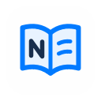

<p align="center">
  
</p>

<h1 align="center">Nomo Scholar</h1>

<p align="center">
  <a href="https://github.com/ZeroDevi1/nomo-mygo/releases/latest">
    
  </a>
  
  <a href="./LICENSE">
    
  </a>
</p>

<p align="center">
  <a href="./README.md">简体中文</a>
  ·
  <a href="./README.en.md"><strong>English</strong></a>
</p>

<p align="center">
  <strong>A local-first academic writing editor for Markdown, LaTeX, and Typst.</strong>
</p>

> [!NOTE]
> **Nomo Scholar** builds on the original Nomo using Go and MyGo.
>
> - **Original Nomo**: [nomo-md/nomo](https://github.com/nomo-md/nomo) by [LIXianSenQwQ](https://github.com/LIXianSenQwQ), built with Tauri + Svelte and rendered in a WebView. Report issues, find releases and install via Homebrew there.
> - **MyGo rewrite (this repository)**: [ZeroDevi1/nomo-mygo](https://github.com/ZeroDevi1/nomo-mygo) keeps the original features, settings format and design, rewritten in Go with the MyGo native UI, with no WebView or Node.js.
> - **MyGo**: a framework for desktop apps in Go, with native UI or a web frontend. Website [mygo.egoist.dev](https://mygo.egoist.dev), repository [egoist/mygo](https://github.com/egoist/mygo), by [EGOIST](https://github.com/egoist).

<p align="center">
  
</p>

## Download and Install

Get the latest version from [GitHub Releases](https://github.com/ZeroDevi1/nomo-mygo/releases/latest).

| Platform | Requirements | Installation |
| :--- | :--- | :--- |
| Windows | Windows 10 / 11, x64 | `.exe` installer / `.zip` portable |
| macOS | macOS 12.0+, Apple Silicon | `.dmg` / `.app.tar.gz` |
| Linux | x64 | `.deb` / `.tar.gz` |

SmartScreen or Gatekeeper may prompt on first launch; download from this project's Releases.

### Homebrew (macOS)

This repository ships its own cask and works as a third-party tap:

```bash
brew tap zerodevi1/nomo-mygo https://github.com/ZeroDevi1/nomo-mygo
brew install --cask zerodevi1/nomo-mygo/nomo-mygo
```

Upgrade with `brew upgrade --cask nomo-mygo`; uninstall with `brew uninstall --cask nomo-mygo` (add `--zap` to also remove settings and drafts).

- The original `nomo` cask shares the settings and recovery directory, `~/Library/Application Support/com.nomo.desktop`. Quit the previous app before opening Nomo Scholar.
- This edition is not notarized yet. If macOS says the developer cannot be verified or the app is damaged, run `xattr -dr com.apple.quarantine "/Applications/Nomo Scholar.app"` and open it again. Older releases use `/Applications/Nomo.app`.

### Scoop (Windows)

This repository is also a Scoop bucket:

```powershell
scoop bucket add nomo-mygo https://github.com/ZeroDevi1/nomo-mygo
scoop install nomo-mygo/nomo-mygo
```

Upgrade with `scoop update nomo-mygo`; uninstall with `scoop uninstall nomo-mygo`. Scoop installs the portable build: the app only notifies you of new versions and does not install them itself. Settings live in `%APPDATA%\com.nomo.desktop` and are kept on uninstall.

## Features

- **LaTeX / Typst**: Open a trusted `.tex` or `.typ` main file to switch between preview, source and split views, click PDF text to locate its source line, or export the current buffer from the File menu. Eligible LaTeX paragraphs update in place before XeLaTeX corrects pagination. Both source editors offer syntax highlighting and completions. See the [compiler dependencies and Go API](docs/typeset-preview.md).
- **Markdown editing**: Live preview, source and split modes, with `/` for quick insertion.
- **Rich content**: Tables, syntax highlighting, math formulas, Mermaid diagrams, callouts and text colors.
- **File management**: Type to locate files in the explorer, work in multiple tabs and edit large TXT / JSON files in segments.
- **Save and restore**: Optional autosave and local Markdown snapshots, plus workspace and reading position restoration.
- **Comfortable writing**: Light and dark themes, [custom color themes and fonts](docs/custom-themes.md) (guide in Chinese), optional fine typography and an always-on-top Markdown mini window.
- **Export and preview**: Export HTML / PDF (paper size, margins, page numbers, header and footer, optional fine typography) / Word (.docx, with editable text and tables, formulas and diagrams as images), and Finder Quick Look previews of Markdown and compiled LaTeX / Typst PDFs on macOS.

See [release notes](https://github.com/ZeroDevi1/nomo-mygo/releases) for version changes.

## Development

The interface is built with Go and the [MyGo](https://github.com/egoist/mygo) native UI (`desktop/`); it is a pure Go project and needs no Node.js. Requires Go 1.27.3 or later. the MyGo CLI is a tool dependency in `go.mod`, run with `go tool mygo`, and the app is configured in `mygo.json`.

- macOS: Xcode Command Line Tools; building the Quick Look extension requires the full Xcode.

```bash
go tool mygo dev
```

- Checks and tests: `go vet ./...` and `go test ./...`
- Packaging: `go tool mygo build`; on macOS, `bash scripts/build-macos.sh` adds the Quick Look extension and the DMG; for the Windows Store package see [desktop/packaging/msix](desktop/packaging/msix/README.md)
- Icons: edit `desktop/packaging/icons/nomo/source/nomo-app-light.svg`, then run `go run ./scripts/icons`
- The fine-typography WebAssembly for exports is generated by `go tool mygo build` (`go run ./scripts/kpwasm`) and is not committed

## Get Involved

[Issues](https://github.com/ZeroDevi1/nomo-mygo/issues) and [pull requests](https://github.com/ZeroDevi1/nomo-mygo/pulls) are welcome; include your OS version, steps to reproduce and a sample when reporting a bug.

Enjoy Nomo Scholar? Star [this project](https://github.com/ZeroDevi1/nomo-mygo) and [the original](https://github.com/nomo-md/nomo), or follow the original author [LIXianSenQwQ](https://github.com/LIXianSenQwQ). Community: [linux.do](https://linux.do/).

Licensed under [AGPL-3.0-or-later](./LICENSE); contact the maintainers for separate commercial licensing. Third-party components retain their own licenses.

Thanks to MyGo, pdfcpu, Lucide and other open-source projects.
