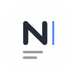

<p align="center">
  
</p>

<h1 align="center">Nomo</h1>

<p align="center">
  <a href="https://github.com/ZeroDevi1/nomo-mygo/releases/latest">
    
  </a>
  
  <a href="./LICENSE">
    
  </a>
</p>

<p align="center">
  <a href="./README.md"><strong>简体中文</strong></a>
  ·
  <a href="./README.en.md">English</a>
</p>

<p align="center">
  <strong>一款本地优先的 Markdown 编辑器，让写作保持简单。</strong>
</p>

> [!NOTE]
> 本仓库是 **Nomo 的 MyGo 重写版**，不是原版 Nomo。
>
> - **原版 Nomo**：[nomo-md/nomo](https://github.com/nomo-md/nomo)，作者 [LIXianSenQwQ](https://github.com/LIXianSenQwQ)，基于 Tauri + Svelte，界面由 WebView 渲染。原版的问题、发布与 Homebrew 安装请到原版仓库。
> - **MyGo 重写版（本仓库）**：[ZeroDevi1/nomo-mygo](https://github.com/ZeroDevi1/nomo-mygo)，沿用原版的功能、设置格式与界面设计，用 Go 与 MyGo 原生 UI 重写，不再依赖 WebView 与 Node.js。
> - **MyGo**：用 Go 编写桌面应用的框架，支持原生 UI 与 Web 前端。官网 [mygo.egoist.dev](https://mygo.egoist.dev)，仓库 [egoist/mygo](https://github.com/egoist/mygo)，作者 [EGOIST](https://github.com/egoist)。

<p align="center">
  
</p>

## 下载与安装

从 [GitHub Releases](https://github.com/ZeroDevi1/nomo-mygo/releases/latest) 下载最新版本。

| 系统 | 要求 | 安装方式 |
| :--- | :--- | :--- |
| Windows | Windows 10 / 11，x64 | `.exe` 安装版 / `.zip` 免安装版 |
| macOS | macOS 12.0+，Apple Silicon | `.dmg` / `.app.tar.gz` |
| Linux | x64 | `.deb` / `.tar.gz` |

首次打开可能出现 SmartScreen / Gatekeeper 提示，请从本项目 Releases 下载。

### Homebrew（macOS）

本仓库自带 cask，作为第三方 tap 添加：

```bash
brew tap zerodevi1/nomo-mygo https://github.com/ZeroDevi1/nomo-mygo
brew install --cask zerodevi1/nomo-mygo/nomo-mygo
```

升级用 `brew upgrade --cask nomo-mygo`，卸载用 `brew uninstall --cask nomo-mygo`（加 `--zap` 同时删除配置与草稿）。

- 官方仓库中的 `nomo` cask 是原版（Tauri），与本版本安装同一个 `Nomo.app`，需先 `brew uninstall --cask nomo` 再安装。
- 本版本暂未经过 Apple 公证，若提示“无法验证开发者”或“已损坏”，执行 `xattr -dr com.apple.quarantine /Applications/Nomo.app` 后再打开。

### Scoop（Windows）

本仓库同时是 Scoop bucket：

```powershell
scoop bucket add nomo-mygo https://github.com/ZeroDevi1/nomo-mygo
scoop install nomo-mygo/nomo-mygo
```

升级用 `scoop update nomo-mygo`，卸载用 `scoop uninstall nomo-mygo`。Scoop 安装的是免安装版：应用内检查到新版本时只提示，不会自行安装；配置保存在 `%APPDATA%\com.nomo.desktop`，卸载不会删除。

## 核心功能

- **Markdown 编辑**：即时预览、源码与双栏模式，输入 `/` 快速插入内容。
- **丰富内容**：支持表格、代码高亮、数学公式、Mermaid 图表、提示块与文字颜色。
- **文件管理**：文件树键入定位、多标签，以及 TXT / JSON 大文件分段编辑。
- **保存与恢复**：可启用自动保存和 Markdown 本地快照，恢复工作区与阅读位置。
- **舒适写作**：浅深色主题、[自定义配色主题与字体](docs/custom-themes.md)、可手动开启的精细排版，以及可置顶的 Markdown 小窗。
- **导出与预览**：导出 HTML / PDF（可设纸张、边距、页码与页眉页脚，可选精细排版）/ Word（.docx，正文与表格可编辑，公式与图表转为图片）；macOS 支持 Quick Look 快速预览。

版本变化请查看[更新记录](https://github.com/ZeroDevi1/nomo-mygo/releases)。

## 开发

界面由 Go 与 [MyGo](https://github.com/egoist/mygo) 原生 UI 构建（`desktop/`），纯 Go 项目，不需要 Node.js。需要 Go 1.27；MyGo 命令行作为 `go.mod` 中的工具依赖，经 `go tool mygo` 运行，应用配置在 `mygo.json`。

- macOS：Xcode Command Line Tools；构建 Quick Look 扩展需要完整 Xcode。

```bash
go tool mygo dev
```

- 检查与测试：`go vet ./...`、`go test ./...`
- 打包：`go tool mygo build`；macOS 含 Quick Look 扩展与 DMG 用 `bash scripts/build-macos.sh`；Windows Store 包见 [desktop/packaging/msix](desktop/packaging/msix/README.md)
- 图标：修改 `desktop/packaging/icons/nomo/source/nomo-app-light.svg` 后运行 `go run ./scripts/icons`
- 导出精细排版的 WebAssembly 由 `go tool mygo build` 自动生成（`go run ./scripts/kpwasm`），不纳入版本库

## 参与项目

欢迎提交 [Issue](https://github.com/ZeroDevi1/nomo-mygo/issues) 或 [Pull Request](https://github.com/ZeroDevi1/nomo-mygo/pulls)；反馈问题时请附系统版本、复现步骤与样例。

喜欢 Nomo，欢迎 Star [本项目](https://github.com/ZeroDevi1/nomo-mygo) 与[原版项目](https://github.com/nomo-md/nomo)，或关注原版作者 [LIXianSenQwQ](https://github.com/LIXianSenQwQ)。社区：[linux.do](https://linux.do/)。

采用 [AGPL-3.0-or-later](./LICENSE) 许可证；商业授权请联系维护者，第三方组件遵循各自许可证。

感谢 MyGo、pdfcpu、Lucide 等开源项目。
